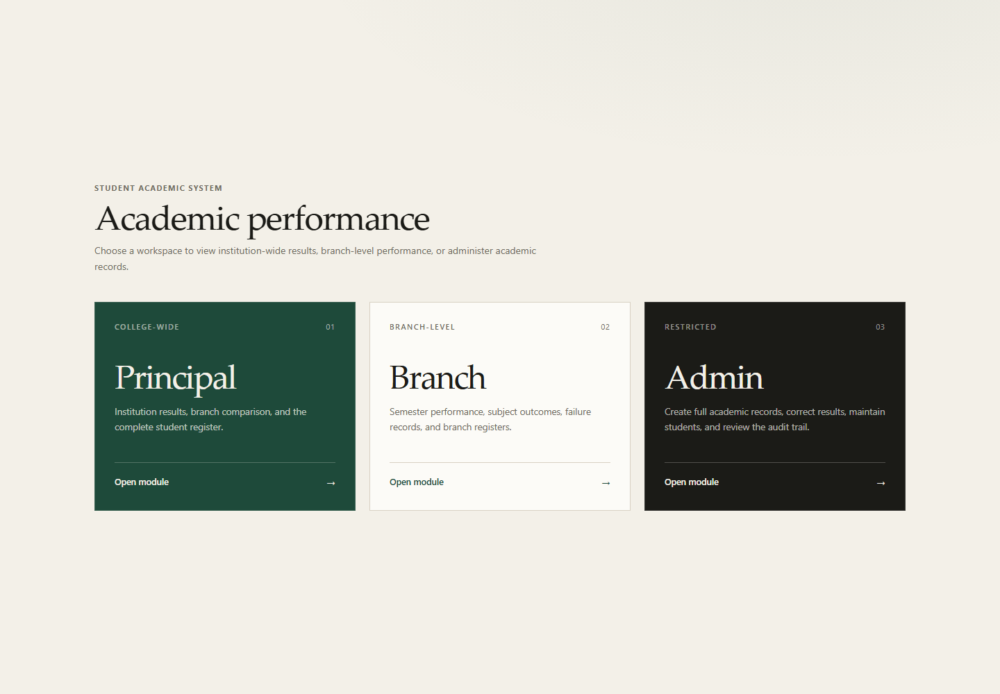
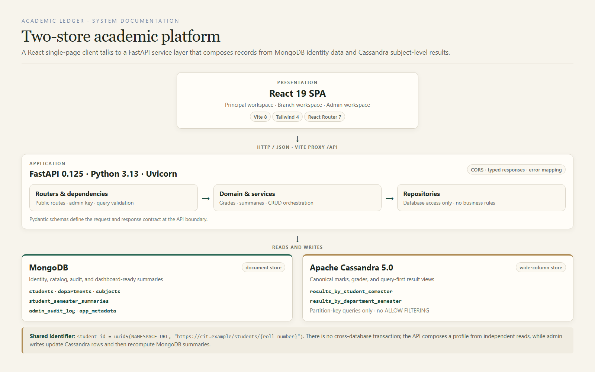

# Academic Ledger

**Student Information and Academic Performance Management System**

A dual-database academic records platform for institution-wide analytics, department-level reporting, student profiles, and audited administrative workflows.


<p align="center">
  
</p>

## Overview

Academic Ledger separates academic identity from academic results and composes them at the API boundary:

- **MongoDB** owns student identity, catalogues, derived semester summaries, and the audit log.
- **Apache Cassandra** owns canonical subject-level results in two query-first tables.
- **FastAPI** validates requests, applies domain rules, and composes cross-store responses.
- **React** provides the Principal, Branch, and Admin workspaces.

The result is a system that supports fast institutional dashboards without weakening the integrity of subject-level records.

## Contents

- [Features](#features)
- [Architecture](#architecture)
- [Technology stack](#technology-stack)
- [Repository structure](#repository-structure)
- [Getting started](#getting-started)
- [Configuration](#configuration)
- [Data and seeding](#data-and-seeding)
- [Running the application](#running-the-application)
- [API reference](#api-reference)
- [Testing](#testing)
- [Benchmark](#benchmark)
- [Documentation](#documentation)
- [Project status](#project-status)

## Features

### Public analytics

- College-wide semester metrics: students, pass rate, average CGPA, and backlog counts.
- Department comparison with pass rate, average CGPA, and backlog rate.
- Filterable and paginated student register with CGPA, backlog, status, and sort controls.
- Branch workspace with department metrics, subject outcomes, failure records, semester movement, and student register.

### Student records

- A single profile composed from MongoDB identity and summaries plus Cassandra result rows.
- Semester-by-semester subject results, SGPA, CGPA, and backlog history.
- Responsive layouts for desktop and narrow mobile viewports.

### Administration

- Create complete four-semester records in simulated or manual modes.
- Update student identity with optional Cassandra name cascade.
- Correct individual subject results.
- Preview and clear selected backlogs.
- Permanently delete a student from both stores.
- Immutable audit trail with before/after snapshots.

### Data integrity

- Deterministic UUID5 student identifiers shared by both databases.
- Explicit write ordering and summary recomputation after result changes.
- Best-effort rollback of prior Cassandra rows when a write fails.
- No cross-database transaction and no hidden query-time join.

## Architecture

<p align="center">
  
</p>

| Concern | Store |
| --- | --- |
| Student identity, departments, subjects | MongoDB |
| Derived semester summaries used by dashboards | MongoDB |
| Canonical subject-level results, marks, grades | Cassandra |
| Catalogue and seeding metadata | MongoDB |
| Audit history and before/after snapshots | MongoDB |

MongoDB and Cassandra share a deterministic student ID derived from the roll number with UUID5. There is no cross-database transaction. A profile is composed in the API from two independent reads.

Cassandra is query-first and denormalised:

- `results_by_student_semester` — partition key `((student_id), semester, subject_code)` for one student's full or semester-specific history.
- `results_by_department_semester` — partition key `((department_code, semester), subject_code, result_status, roll_number)` for department, subject, and failure-list queries.

See [schema and queries](docs/schema-and-queries.md) for CQL, indexes, and aggregation examples.

## Technology stack

| Layer | Technology | Role |
| --- | --- | --- |
| Client | React 19.3.1, React Router 7.18.4 | Workspace routing, profiles, filters, admin dialogs |
| Build and styling | Vite 8.3.4, Tailwind CSS 4.3.3 | Development server, production build, editorial UI |
| API | FastAPI 0.125.0, Uvicorn 0.38.0 | Typed HTTP routes, validation, ASGI serving |
| Contracts | Pydantic 2.12.5, pydantic-settings 2.12.0 | Request/response schemas and environment settings |
| Document store | MongoDB, PyMongo 4.19.0 | Identity, summaries, catalogue, audit |
| Wide-column store | Apache Cassandra 5.0, cassandra-driver 3.30.1 | Canonical subject results |
| Tooling | pytest 9.0.2, httpx 0.28.1, Docker Compose | Tests, API client, local Cassandra service |

## Repository structure

```text
backend/
  app/
    api/            FastAPI routes, dependencies, health checks
    core/           settings and application errors
    db/             MongoDB and Cassandra connectivity
    domain/         catalogue, grade rules, aggregation helpers
    repositories/   database access only
    schemas/        request and response models
    services/       orchestration and domain validation
  scripts/          init_db.py, seed.py, verify_data.py
  tests/            domain, admin, and live API contract tests
benchmarks/         equivalent-operation benchmark and results
docs/               schema notes, diagrams, screenshots, project report
frontend/           React application
compose.yaml        local Cassandra 5.0 service
```

## Getting started

### Prerequisites

- Python 3.13+
- Node.js 22+
- Docker
- MongoDB (local instance or MongoDB Atlas)

### 1. Start Cassandra

From the project root:

```bash
docker compose up -d
```

### 2. Configure the environment

```bash
cp .env.example .env
```

Edit `.env` and set `MONGODB_URI`, the Cassandra connection details, and a private `ADMIN_ACCESS_KEY`.

### 3. Install the backend

From the project root:

```bash
cd backend
python -m venv .venv
.venv/Scripts/python -m pip install -r requirements-dev.txt
```

On macOS or Linux:

```bash
cd backend
python3 -m venv .venv
source .venv/bin/activate
python -m pip install -r requirements-dev.txt
```

The Python 3.13 Cassandra driver requires `pyasyncore`; it is installed from `requirements.txt` and activated before importing the driver in `app/db/reactor.py`.

### 4. Install the frontend

From the project root:

```bash
cd frontend
npm install
```

### 5. Initialise and seed the data

From the project root, enter `backend`:

```bash
cd backend
.venv/Scripts/python scripts/init_db.py
.venv/Scripts/python scripts/seed.py
```

The scripts are idempotent upserts. `seed.py --cassandra-only` seeds only Cassandra for driver or data checks. `seed.py --reset` clears the demo collections and both Cassandra tables before reseeding; use it only when a clean 500-student dataset is required.

## Configuration

| Variable | Required | Description |
| --- | --- | --- |
| `MONGODB_URI` | Yes | Local MongoDB or MongoDB Atlas connection string |
| `MONGODB_DATABASE` | Yes | MongoDB database name, default `academic_system` |
| `CASSANDRA_HOST` | Yes | Cassandra host, default `127.0.0.1` |
| `CASSANDRA_PORT` | Yes | Cassandra native transport port, default `9042` |
| `CASSANDRA_KEYSPACE` | Yes | Cassandra keyspace, default `academic_system` |
| `ADMIN_ACCESS_KEY` | Yes | Passcode for `X-Admin-Key` admin requests |

If using MongoDB Atlas, allow the API's public IP in Network Access. TLS handshake failures during startup generally indicate that the client IP is not allow-listed.

> **Security note:** the admin key is a demo access control, not a replacement for per-user authentication or role-based authorisation. Never commit `.env` or expose connection strings and keys in logs, screenshots, or issues.

## Data and seeding

The deterministic seed creates:

- 5 departments: CSE, ECE, EEE, MECH, and CIVIL.
- 100 students per department, 500 total.
- Semesters 1 through 4, five subjects per semester.
- 2,000 semester summaries.
- 10,000 subject results per Cassandra table.
- 105 failed subject results in the fresh seed.
- 68 students with at least one backlog at Semester 4 in the fresh seed.

The pass mark is 40. CGPA is cumulative across all four semesters. Backlog counts are cumulative failed subjects. Admins can clear selected backlogs; affected Cassandra rows and every stored summary are updated together.

Seed version: `2025-26.2`  
Random seed: `20260723`

### Verification caveat

The live demonstration dataset is intentionally not pristine: one backlog for `24CSE006` (Semester 4, CS404) was cleared through the admin workflow. The live demo therefore has 104 failed subject results and 67 students with a current Semester 4 backlog. `verify_data.py` compares live data against a freshly generated seed, so it passes only after `seed.py --reset`.

## Running the application

Run the backend and frontend in separate terminals from the project root.

### Backend

```bash
cd backend
.venv/Scripts/python -m uvicorn app.main:app --reload --port 8000
```

### Frontend

```bash
cd frontend
npm run dev
```

Open `http://127.0.0.1:5173`. Vite proxies `/api` to `127.0.0.1:8000`. Interactive API documentation is available at `http://127.0.0.1:8000/docs`.

## API reference

### Public endpoints

| Method | Endpoint | Purpose |
| --- | --- | --- |
| `GET` | `/api/health` | MongoDB and Cassandra health |
| `GET` | `/api/departments?semester=4` | Department catalogue |
| `GET` | `/api/departments/{code}/subjects?semester=4` | Department subjects |
| `GET` | `/api/students` | Filtered and paginated student register |
| `GET` | `/api/students/{id}` | Student identity and summaries |
| `GET` | `/api/students/{id}/results` | Subject-level results |
| `GET` | `/api/students/{id}/comparison` | Semester comparison |
| `GET` | `/api/results/failures` | Failure list by department, semester, and subject |
| `GET` | `/api/analytics/overview` | Semester overview metrics |
| `GET` | `/api/analytics/departments` | Department comparison |
| `GET` | `/api/analytics/subjects` | Subject outcomes |
| `GET` | `/api/analytics/trends` | Department trend data |

### Admin endpoints

Admin routes require the `X-Admin-Key` header.

| Method | Endpoint | Purpose |
| --- | --- | --- |
| `GET` | `/api/admin/students` | Admin register search |
| `POST` | `/api/admin/students/preview` | Preview a simulated student record |
| `POST` | `/api/admin/students` | Create a student |
| `PATCH` | `/api/admin/students/{id}` | Update a student profile |
| `DELETE` | `/api/admin/students/{id}` | Delete a student from both stores |
| `GET` | `/api/admin/students/{id}/record` | Full administrative record |
| `PUT` | `/api/admin/students/{id}/results/{semester}/{subject_code}` | Correct a subject result |
| `GET` | `/api/admin/students/{id}/backlogs` | List current backlogs |
| `POST` | `/api/admin/students/{id}/backlogs/preview` | Preview backlog clearance |
| `POST` | `/api/admin/students/{id}/backlogs/clear` | Apply backlog clearance |
| `GET` | `/api/admin/audit` | Paginated audit history |

## Testing

Run the non-integration suite from `backend`:

```bash
.venv/Scripts/python -m pytest -m "not integration" -q
```

Run the full suite against seeded MongoDB and Cassandra:

```bash
RUN_INTEGRATION=1 .venv/Scripts/python -m pytest -q
```

PowerShell:

```powershell
$env:RUN_INTEGRATION="1"; .venv/Scripts/python -m pytest -q
```

The recorded full run passed 21 tests. Integration tests cover health, counts, filters, pagination, profiles, cross-store aggregation, and failure-list consistency with Cassandra.

Validate the frontend from `frontend`:

```bash
npm run lint
npm run build
```

## Benchmark

```bash
cd backend
MONGODB_URI="<atlas-or-local-uri>" .venv/Scripts/python ../benchmarks/benchmark.py
```

| System | Median | p95 | Min | Max |
| --- | ---: | ---: | ---: | ---: |
| MongoDB | 5.299 ms | 11.354 ms | 2.446 ms | 35.970 ms |
| Cassandra | 30.409 ms | 59.563 ms | 12.108 ms | 629.024 ms |

The benchmark compares the same department-semester pass/fail aggregation. MongoDB reads pre-aggregated summaries; Cassandra reads and groups subject rows. This reflects different data models and access patterns, not an engine-only comparison. Full details: [benchmarks/RESULTS.md](benchmarks/RESULTS.md).

## Documentation

- [Project report](docs/Project_Documentation.docx) — 23-page report covering the implemented system.
- [Schema and queries](docs/schema-and-queries.md) — CQL, indexes, and aggregation examples.
- [Benchmark results](benchmarks/RESULTS.md) — environment, method, and measured latency.
- [Interface screenshots](docs/screenshots) — desktop and mobile captures.
- [Architecture diagrams](docs/diagrams) — architecture, data model, request, CRUD, and backlog flows.

## Project status

| Area | Status |
| --- | --- |
| Cassandra schema and seed | Complete and verified |
| MongoDB schema and seed | Complete and verified against local MongoDB |
| Backend API | Implemented and covered by domain and contract tests |
| Admin workflows | CRUD, result correction, backlog clearance, deletion, and audit |
| Frontend | All routes implemented; build and ESLint passing |
| Documentation | Report, schema notes, diagrams, and screenshots included |
| Benchmark | Recorded against local MongoDB and local Cassandra |

### Known limitations

- The admin key is shared and demo-oriented; there is no individual authentication or RBAC.
- There is no distributed transaction or durable cross-store repair process.
- The validated topology is a single-node local Cassandra service, not a production cluster.
- MongoDB and Cassandra latency figures depend on the local topology and data shape.
